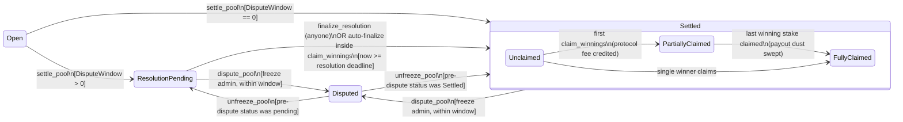

# Claim Lifecycle: Resolved, Finalized, and Claimed

"Settled" gets used for three different things in Predinex. This page separates them and lists which view reports each one:

| Term | Meaning | Scope | Recorded as |
|---|---|---|---|
| **Resolved** | A winning outcome has been declared by `settle_pool` / `settle_pools`. | Pool | `PoolStatus::ResolutionPending(w)` or `PoolStatus::Settled(w)`; `pool.settled == true` |
| **Finalized** | The resolution can no longer be challenged, so winners may claim. | Pool | `PoolStatus::Settled(w)` |
| **Claimed** | A user has withdrawn their payout or refund. | **Per user**, not per pool | The user's `UserBet` record is deleted; pool totals accumulate in `PoolPayoutState` |

A pool can be resolved but not finalized. A finalized pool can have any mix of claimed and unclaimed winners. "Claimed" is never a pool status.

For the full market state machine (scheduling, freezing, voiding, cancelling), see [`MARKET_LIFECYCLE.md`](./MARKET_LIFECYCLE.md). This page only covers what happens from settlement onwards.

---

## 1. State diagram

The nested `Settled` states are **not** contract statuses. They are derived from `get_pool_payout_state` (see §4) and are shown here only to make clear that claiming happens inside `Settled`.

---

## 2. Resolved

`settle_pool(caller, pool_id, winning_outcome)` resolves a pool. The caller must be the admin, the pool creator, or the pool's delegated settler (see [`ORACLE_CONFIGURATION_GUIDE.md`](./ORACLE_CONFIGURATION_GUIDE.md)). The call:

1. Sets `pool.settled = true` and `pool.winning_outcome = Some(w)`.
2. Sets the status according to the contract-wide dispute window (`get_dispute_window`, configured by the freeze admin with `set_dispute_window`):
   - **Window = 0** (default): `Settled(w)`. The pool is resolved *and* finalized in one step.
   - **Window > 0**: `ResolutionPending(w)`. It also stores `PoolResolutionDeadline = settlement_time + window`, which you can read with `get_resolution_deadline(pool_id)`.
3. Locks the settlement fee rate for the pool (`PoolFeeBps`), records `PoolSettlementTime`, `PoolSettlementSource` and `PoolSettlementProtocolFee`, and emits `settle_pool`.

A resolved pool cannot be re-settled. A second `settle_pool` fails with `PoolAlreadySettled`.

## 3. Finalized

Only `Settled(w)` is final. A `ResolutionPending(w)` pool becomes `Settled(w)` once `now >= PoolResolutionDeadline`, through either of these paths:

| Path | Who | Event |
|---|---|---|
| `finalize_resolution(pool_id)` | Anyone. No auth required, and **not** blocked by the global pause. | `resolution_finalized` with `auto = false` |
| `claim_winnings` / `claim_all_winnings` / `claim_multi_asset_winnings` | The first winner to claim after the deadline. | `resolution_finalized` with `auto = true`, followed by `claim_winnings` |

Errors on this path:

| Error | Code | When |
|---|---|---|
| `ResolutionNotFinal` | 94 | Claim or finalize attempted before the deadline. |
| `ResolutionNotPending` | 95 | `finalize_resolution` called on a pool that is not `ResolutionPending` (already `Settled`, `Disputed`, still `Open`, …). |

### Disputes interrupt finalization

While the dispute window is open, the freeze admin can call `dispute_pool`. This works on both `ResolutionPending` and `Settled` pools, provided `now <= settlement_time + window`; otherwise it fails with `DisputeWindowExpired` (78). The pool moves to `Disputed` and claims fail with `PoolIsDisputed` (17). On a `ResolutionPending` pool, the challenge is also appended to `get_pool_challenges(pool_id)` and `resolution_challenged` is emitted.

`unfreeze_pool` restores the **pre-dispute status** unchanged. A pool that was pending goes back to `ResolutionPending(w)` with its *original* deadline. If that deadline has already passed, the pool can be finalized immediately.

Re-settling to a different outcome is not possible, and `void_pool` only accepts `Open` pools. If a review concludes the declared outcome is wrong, the pool has to stay `Disputed` until it is handled off-chain or by a contract upgrade.

> With the default window of `0`, a dispute is only accepted in a ledger with the same timestamp as the settlement. In practice, settlements are final as soon as they land. Configure a positive window before relying on disputes.

## 4. Claimed

Claiming is per user:

- `claim_winnings(user, pool_id)` requires `Settled(w)`, or `ResolutionPending(w)` past its deadline (it auto-finalizes). It pays `floor(user_winning_stake × (total − fee) / winning_total)` and deletes the user's `UserBet`. A second claim fails with `NoBetFound` (23).
- `claim_refund(user, pool_id)` is the equivalent for `Voided` / `Cancelled` pools. It returns the full net stake.

The pool-level view is `get_pool_payout_state(pool_id) -> Option<PoolPayoutState>`:

| Field | Meaning |
|---|---|
| `fee_credited` | `true` after the first winner claim. The settlement fee is credited to the treasury (and LP split) at that point, not at settlement. |
| `claimed_winning_stake` | Sum of the winning stakes that have been claimed. |
| `paid_out` | Sum of payouts transferred to winners. |

The pool is **fully claimed** when `claimed_winning_stake` equals the winning outcome's total. On that final claim, the floor-division dust is swept to the treasury, so that `total == fee + dust + Σ payouts`.

---

## 5. Which view reports what

Not every read path tells `ResolutionPending` apart from `Settled`. Before you trust a view for claim eligibility, check this table.

| View | Resolved, pending (`ResolutionPending`) | Finalized (`Settled`) | Claimed |
|---|---|---|---|
| `get_pool(pool_id).status` (contract) | `ResolutionPending(w)` ✅ distinct | `Settled(w)` | Not reported |
| `get_pool(pool_id).settled` (contract) | `true` | `true` | Not reported |
| `get_resolution_deadline(pool_id)` | `Some(deadline)` | `Some(deadline)` if a window was active, else `None` | — |
| `get_claim_status(pool_id, user)` | ⚠️ `Claimable` for winners, even before the deadline | `Claimable` / `NotEligible` | `AlreadyClaimed` |
| `preview_claimable_amount(pool_id, user)` | ⚠️ `Claimable(amount)` even before the deadline | `Claimable(amount)` / `NotEligible` | `NeverBet` (record deleted) |
| `get_pool_payout_state(pool_id)` | `None` | `None` until the first claim | `fee_credited`, `claimed_winning_stake`, `paid_out` |
| `get_user_claim_history(user, …)` / `get_total_user_claims(user)` | — | — | Per-user claim records |
| Events | `settle_pool` (+ `resolution_challenged` / `pool_disputed`) | `settle_pool` (window 0) or `resolution_finalized` | `claim_winnings` |
| Web (`web/app/lib/soroban-read-api.ts`) | `'settled'`: the `ResolutionPending` tag is unmapped, so it falls back to `pool.settled == true` | `'settled'` | Via `get_user_portfolio` → `claimStatus` |
| HTTP API (`MarketStatus` in `api/src/services/market-query.ts`) | `settled` | `settled` | Not reported |
| Settlement bot (`bot/src/contract-client.ts`) | Status tag is not in `KNOWN_POOL_STATUS_TAGS`, so the pool is logged and skipped | Skipped (`PoolAlreadySettled`) | — |

Practical rules for integrators:

1. **Claim eligibility = `get_claim_status == Claimable` AND (`status` is `Settled`, OR `now >= get_resolution_deadline`).** `get_claim_status` alone will mark pending pools as claimable, and the claim then reverts with `ResolutionNotFinal`.
2. Show a countdown to `get_resolution_deadline` for `ResolutionPending` pools, rather than a "Claim" button.
3. `AlreadyClaimed` is inferred from the missing bet record. It cannot tell a past claim apart from "never bet" unless you also check the user's claim history or events.
