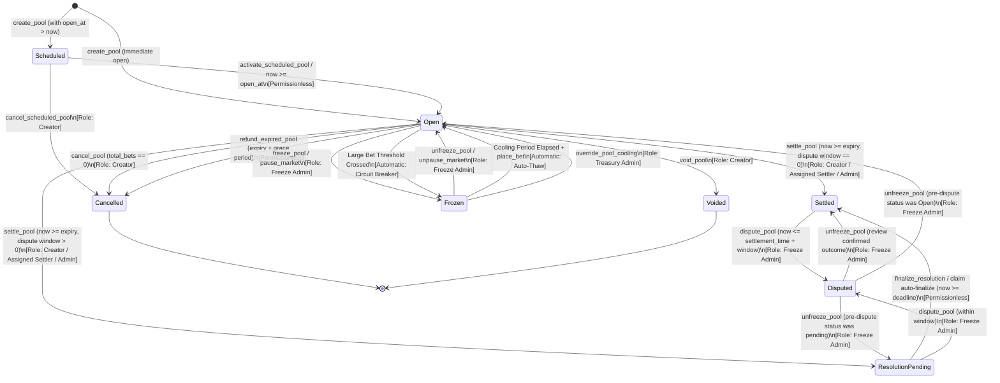

# Market Lifecycle State Machine

This document provides a comprehensive reference for the lifecycle state machine of prediction markets (pools) in the Predinex Soroban smart contract. It describes all market states, possible transitions between them, the triggers and permissioned roles required for each transition, and includes a detailed state transition diagram.

---

## 1. Overview of Market States

Every prediction pool in Predinex maintains an explicit status represented by the [`PoolStatus` enum](../contracts/predinex/src/lib.rs#L1798).

There are **8 states** in the market lifecycle. For the difference between *resolved*, *finalized*, and *claimed*, see [`CLAIM_LIFECYCLE.md`](./CLAIM_LIFECYCLE.md).

| Status | Type | Description | Allowed Operations |
|---|---|---|---|
| **`Scheduled(open_at)`** | Non-terminal | Market parameters are stored on-chain, but betting does not open until the `open_at` Unix timestamp is reached. | Pool cancellation by creator. No bets allowed. |
| **`Open`** | Non-terminal | Market is actively accepting bets. Expiry has not yet passed. | `place_bet`, `cancel_bet`, `cancel_pool` (if 0 bets), `freeze_pool`, `void_pool`, `settle_pool` (after expiry). |
| **`Frozen`** | Non-terminal | Market is temporarily halted (due to manual admin action or automatic circuit-breaker cooling). Betting and claim payouts are blocked. Read-only queries remain available. | `unfreeze_pool` (admin), `override_pool_cooling` (treasury admin), auto-thaw on bet after cooling window. |
| **`ResolutionPending(winning_outcome)`** | Non-terminal | Winning outcome declared while a dispute window is configured (`get_dispute_window() > 0`). Not final: claims revert with `ResolutionNotFinal` until `get_resolution_deadline(pool_id)` passes. | `finalize_resolution` (anyone, after deadline), auto-finalize on claim, `dispute_pool` (within window). |
| **`Settled(winning_outcome)`** | Provisional / final after dispute window | Betting is closed and a winning outcome is declared. The status remains `Settled` after claims; a dispute can move it to `Disputed` while the dispute window is open. | `claim_winnings`, `dispute_pool` (during dispute window). |
| **`Disputed`** | Non-terminal | A settlement outcome is challenged during the dispute window. Payout claims are suspended pending review. | `unfreeze_pool` (restores pre-dispute status or re-settles). Claims are blocked. |
| **`Voided`** | Terminal | The creator declared an open market void. Full refunds are enabled for all participants. | `claim_refund`. No new bets or settlements. |
| **`Cancelled`** | Terminal | A scheduled market or empty open market was cancelled, or an expired single-asset market entered its refund sweep. Creator cancellations return the creation deposit; expired-market refunds are paid to bettors. | `claim_refund` for any remaining bettor; `refund_expired_pool` continues an in-progress expired-market sweep. The state cannot reactivate. |

---

## 2. State Machine Diagram

The following Mermaid diagram maps the complete market lifecycle, including all transitions, conditions, and roles:

`claim_winnings` and expiry do not change the stored `Settled` status; they are
not state transitions.

---

## 3. Transition Matrix

The table lists every state transition, its preconditions, responsible actor,
mode, emitted event, and a direct link to the Soroban entrypoint:

| Source | Target | Contract entrypoint | Preconditions | Responsible actor | Mode / emitted event |
|---|---|---|---|---|---|
| `[*]` | `Scheduled(open_at)` | [`create_pool`](../contracts/predinex/src/lib.rs#L4731) | Creation arguments are valid and `open_at` is in the future. | Pool creator | Permissioned; `create_pool`, `pool_scheduled` |
| `[*]` | `Open` | [`create_pool`](../contracts/predinex/src/lib.rs#L4731) | Creation arguments are valid and no future `open_at` was supplied. | Pool creator | Permissioned; `create_pool` |
| `Scheduled(open_at)` | `Open` | [`activate_scheduled_pool`](../contracts/predinex/src/lib.rs#L5000) | Current ledger timestamp is at or after `open_at`. | Any caller | Permissionless; `scheduled_pool_activated` |
| `Scheduled(open_at)` | `Cancelled` | [`cancel_scheduled_pool`](../contracts/predinex/src/lib.rs#L5066) | Pool is still scheduled and caller is its creator. | Pool creator | Permissioned; `scheduled_pool_cancelled` |
| `Open` | `Cancelled` | [`cancel_pool`](../contracts/predinex/src/lib.rs#L6114) | `total_pool == 0` and caller is the creator. | Pool creator | Permissioned; `cancel_pool` |
| `Open` | `Frozen` | [`freeze_pool`](../contracts/predinex/src/lib.rs#L8700) / [`pause_market`](../contracts/predinex/src/lib.rs#L9025) | Pool is open and caller is the freeze admin. | Freeze admin | Permissioned; `pool_frozen` / `MarketPaused` |
| `Open` | `Frozen` | [`place_bet`](../contracts/predinex/src/lib.rs#L5177) | A bet crosses the configured large-pool threshold. | Circuit breaker | Automatic; `pool_cooling_started` |
| `Frozen` | `Open` | [`unfreeze_pool`](../contracts/predinex/src/lib.rs#L8945) / [`unpause_market`](../contracts/predinex/src/lib.rs#L9032) | Pool is frozen and caller is the freeze admin. | Freeze admin | Permissioned; `pool_unfrozen` / `MarketUnpaused` |
| `Frozen` | `Open` | [`place_bet`](../contracts/predinex/src/lib.rs#L5177) | The pool has a cooling deadline and the current timestamp is at or after it. | Any bettor | Automatic auto-thaw; `pool_unfrozen` |
| `Frozen` | `Open` | [`override_pool_cooling`](../contracts/predinex/src/lib.rs#L9043) | Freeze was caused by circuit-breaker cooling and caller is treasury admin. | Treasury admin | Permissioned; `pool_cooling_overridden` |
| `Open` | `Settled(outcome)` | [`settle_pool`](../contracts/predinex/src/lib.rs#L6712) | Expiry has passed, dispute window is zero, and caller is an authorized settler. | Creator / assigned settler / admin | Permissioned; `settle_pool` |
| `Open` | `ResolutionPending(outcome)` | [`settle_pool`](../contracts/predinex/src/lib.rs#L6712) | Expiry has passed, dispute window is positive, and caller is an authorized settler. | Creator / assigned settler / admin | Permissioned; `settle_pool` |
| `ResolutionPending(outcome)` | `Settled(outcome)` | [`finalize_resolution`](../contracts/predinex/src/lib.rs#L6797) or [`claim_winnings`](../contracts/predinex/src/lib.rs#L7406) | Resolution deadline has passed without an accepted dispute. | Any caller / claimant | Permissionless or automatic on claim; `resolution_finalized` |
| `ResolutionPending(outcome)` | `Disputed` | [`dispute_pool`](../contracts/predinex/src/lib.rs#L8828) | Dispute window is still open and caller is freeze admin. | Freeze admin | Permissioned; `resolution_challenged`, `pool_disputed` |
| `Settled(outcome)` | `Disputed` | [`dispute_pool`](../contracts/predinex/src/lib.rs#L8828) | Current time is within the configured dispute window and caller is freeze admin. | Freeze admin | Permissioned; `pool_disputed` |
| `Disputed` | `ResolutionPending(outcome)` | [`unfreeze_pool`](../contracts/predinex/src/lib.rs#L8945) | The disputed pool was pending resolution and review restores that pending state. | Freeze admin | Permissioned; `pool_unfrozen` |
| `Disputed` | `Settled(outcome)` | [`unfreeze_pool`](../contracts/predinex/src/lib.rs#L8945) | Review confirms the settled outcome and caller is freeze admin. | Freeze admin | Permissioned; `pool_unfrozen`, `MarketUnpaused` |
| `Disputed` | `Open` | [`unfreeze_pool`](../contracts/predinex/src/lib.rs#L8945) | Review restores the pool's prior open state and caller is freeze admin. | Freeze admin | Permissioned; `pool_unfrozen`, `MarketUnpaused` |
| `Open` | `Voided` | [`void_pool`](../contracts/predinex/src/lib.rs#L6891) | Pool status is `Open` and caller is its creator. | Pool creator | Permissioned; `void_pool` |
| `Open` | `Cancelled` | [`refund_expired_pool`](../contracts/predinex/src/lib.rs#L7233) | Pool is single-asset and remains unsettled until expiry plus the refund grace period. | Any caller | Permissionless; `expired_refund_sweep_started`, `refund_expired_pool` |

---

## 4. Role Taxonomy & Permissions

| Role | Definition in Contract | Permissions |
|---|---|---|
| **Pool Creator** | The account that signed `create_pool` and paid the creation deposit. | Can cancel empty market (`cancel_pool`), cancel scheduled market (`cancel_scheduled_pool`), void market (`void_pool`), settle market (`settle_pool`), or delegate settlement (`assign_settler`). |
| **Freeze Admin** | Dedicated administrative security account set by contract admin (`set_freeze_admin`). | Can manually freeze any market (`freeze_pool` / `pause_market`), unfreeze markets (`unfreeze_pool` / `unpause_market`), dispute settlements (`dispute_pool`), and configure dispute windows (`set_dispute_window`). |
| **Treasury Admin** | Contract recipient address (`DataKey::TreasuryRecipient`). | Can override automatic circuit-breaker cooling freezes (`override_pool_cooling`) and pause/unpause the entire contract globally (`set_paused`). Cannot bypass freeze admin manual locks. |
| **Assigned Settler** | Account delegated by the creator via `assign_settler`. | Can settle the market (`settle_pool`) once expiry timestamp has passed. |
| **Bettor / Participant** | Any Stellar account placing a bet or claiming funds. | Can place bets, cancel bets before lockup, trigger auto-thaw after cooling period, claim winnings, and claim refunds. |

---

## 5. Invariants and Safety Guarantees

1. **Cancellation Guarantee**: Creator-initiated `cancel_pool` can only transition an `Open` market to `Cancelled` if **zero bets** have been accepted (`total_pool == 0`). A separate permissionless `refund_expired_pool` path moves an unsettled single-asset market to `Cancelled` after expiry plus the grace period so bettor refunds can be swept in batches.
2. **Circuit Breaker vs. Manual Freeze**:
   - An automatic cooling freeze writes a `PoolCoolingUntil` entry and auto-thaws when the cooling duration elapses.
   - A manual administrative freeze via `freeze_pool` writes no cooling deadline and **must** be lifted by the Freeze Admin via `unfreeze_pool`. Treasury overrides cannot bypass manual administrative freezes.
3. **Dispute Window Protection**:
   - When a market is settled, `PoolSettlementTime` is recorded.
   - A dispute can only be filed within `DisputeWindow` seconds, configured by the freeze admin via `set_dispute_window`. It defaults to `0`, meaning settlement is immediately final. Once this window elapses, the settlement outcome is final and disputes revert with `DisputeWindowExpired`.
   - With a positive window, settlement lands in `ResolutionPending` and claims are blocked until the window closes. See [`CLAIM_LIFECYCLE.md`](./CLAIM_LIFECYCLE.md).
4. **Terminal States**:
   - `Cancelled` and `Voided` are strictly terminal. No subsequent transition can reactivate the market.
   - In a `Voided` market, winnings cannot be claimed; instead, all bettors can call `claim_refund` to receive 100% of their deposited principal.

---

## 6. On-Chain vs Off-Chain Responsibilities

The market lifecycle is **owned by the Soroban contract**; everything off-chain is a projection of it.

| Concern | On-chain (`contracts/predinex`) | Off-chain (`api/`, `web/`) |
|---|---|---|
| State ownership | The `PoolStatus` enum is the single source of truth. Only contract entrypoints may transition a pool. | Never mutates status. Reads are served from indexed projections and refreshed after each transaction confirms. |
| Transitions | `create_pool`, `activate_scheduled_pool`, `freeze_pool` / `unfreeze_pool`, `settle_pool`, `dispute_pool`, `void_pool`, `cancel_pool` / `cancel_scheduled_pool`. | Submits transactions on behalf of the wallet holder, then polls/re-indexes until the emitted event is observed. |
| Authorization | Enforced by the roles in §4 (creator, freeze admin, treasury admin, assigned settler). | Surfaces only the actions the connected wallet may take; the contract remains the enforcement point. |
| Events | Emits the events listed in §3 (`create_pool`, `pool_frozen`, `settle_pool`, …). | The HTTP indexer (`api/src/routes/markets.ts`) consumes these events to maintain the read model (`open` / `settled` / `voided` / `cancelled` / `archived` in `api/src/services/market-query.ts`). |
| Terminality & refunds | `claim_refund` / `claim_winnings` move funds; terminal states are enforced in the contract. | Displays claim eligibility; a claim is only shown as available once the projected status allows it. |
| Soft deletes | Not represented on-chain. | The API supports archiving resolved markets (soft delete); archived markets are hidden from default listings but never alter the on-chain status. |

**Rule of thumb:** if a transition moves funds or changes who may act, it happens on-chain; if it only changes what users see, it happens off-chain.

---

## 7. HTTP API Status Mapping

The REST read model uses a smaller vocabulary than the contract (`MarketStatus` in `api/src/services/market-query.ts`). When projecting on-chain `PoolStatus` into API records, use this mapping:

| Contract `PoolStatus` | API `MarketStatus` | Notes |
|---|---|---|
| `Scheduled(open_at)` | `open` | Scheduled markets are listed as `open`; the contract rejects bets until `open_at`. |
| `Open` | `open` | Accepting bets. |
| `Frozen` | `open` | Frozen markets stay listed as `open`; the contract blocks bets/claims while frozen. |
| `ResolutionPending(_)` | `settled` | Not yet claimable; check `get_resolution_deadline`. See [`CLAIM_LIFECYCLE.md`](./CLAIM_LIFECYCLE.md#5-which-view-reports-what). |
| `Settled(_)` | `settled` | |
| `Disputed` | `settled` | Projections are refreshed once the dispute resolves. |
| `Voided` | `voided` | Refund-eligible. |
| `Cancelled` | `cancelled` | |
| *(any terminal state)* | `archived` | Off-chain soft delete via `POST /api/markets/admin/archive-resolved`; never mutates on-chain state. |
