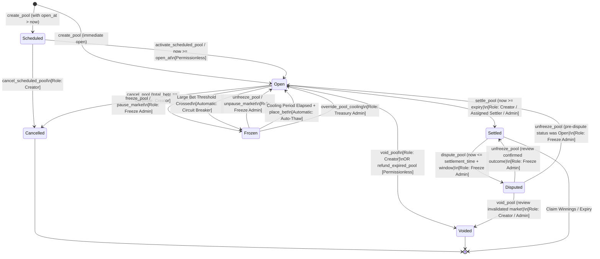

# Market Lifecycle State Machine

This document provides a comprehensive reference for the lifecycle state machine of prediction markets (pools) in the Predinex Soroban smart contract. It describes all market states, possible transitions between them, the triggers and permissioned roles required for each transition, and includes a detailed state transition diagram.

---

## 1. Overview of Market States

Every prediction pool in Predinex maintains an explicit status represented by the `PoolStatus` enum in `contracts/predinex/src/lib.rs`.

There are **7 states** in the market lifecycle:

| Status | Type | Description | Allowed Operations |
|---|---|---|---|
| **`Scheduled(open_at)`** | Non-terminal | Market parameters are stored on-chain, but betting does not open until the `open_at` Unix timestamp is reached. | Pool cancellation by creator. No bets allowed. |
| **`Open`** | Non-terminal | Market is actively accepting bets. Expiry has not yet passed. | `place_bet`, `cancel_bet`, `cancel_pool` (if 0 bets), `freeze_pool`, `void_pool`, `settle_pool` (after expiry). |
| **`Frozen`** | Non-terminal | Market is temporarily halted (due to manual admin action or automatic circuit-breaker cooling). Betting and claim payouts are blocked. Read-only queries remain available. | `unfreeze_pool` (admin), `override_pool_cooling` (treasury admin), auto-thaw on bet after cooling window. |
| **`Settled(winning_outcome)`** | Terminal / Provisional | Betting is closed, market outcome is resolved, and winning outcome is declared. Winners can claim payouts unless disputed. | `claim_winnings`, `dispute_pool` (during dispute window). |
| **`Disputed`** | Non-terminal | A settlement outcome is challenged during the dispute window. Payout claims are suspended pending review. | `unfreeze_pool` (restores pre-dispute status or re-settles). Claims are blocked. |
| **`Voided`** | Terminal | Market was declared void (by creator or due to expiry without settlement). Full refunds are enabled for all participants. | `claim_refund`. No new bets or settlements. |
| **`Cancelled`** | Terminal | Market was cancelled before activation or before any bets were placed. Deposits are returned to the creator. | None. Terminal state. |

---

## 2. State Machine Diagram

The following Mermaid diagram maps the complete market lifecycle, including all transitions, conditions, and roles:

---

## 3. Transition Matrix

The table below details every valid state transition, what triggers it, whether it is permissioned or automatic, the required caller role, and the on-chain events emitted:

| Source State | Target State | Trigger Function / Event | Execution Mode | Required Role | Emitted Events |
|---|---|---|---|---|---|
| `[*] (None)` | `Scheduled(open_at)` | `create_pool` with `open_at > timestamp` | Permissioned | Pool Creator | `create_pool`, `pool_scheduled` |
| `[*] (None)` | `Open` | `create_pool` with `open_at == None` or `<= now` | Permissioned | Pool Creator | `create_pool` |
| `Scheduled(open_at)` | `Open` | `activate_scheduled_pool(pool_id)` when `now >= open_at` | Automatic / Permissionless | Any Caller | `scheduled_pool_activated` |
| `Scheduled(open_at)` | `Cancelled` | `cancel_scheduled_pool(pool_id)` | Permissioned | Pool Creator | `scheduled_pool_cancelled` |
| `Open` | `Cancelled` | `cancel_pool(pool_id)` when `total_pool == 0` | Permissioned | Pool Creator | `cancel_pool` |
| `Open` | `Frozen` | `freeze_pool(pool_id)` or `pause_market(pool_id)` | Permissioned | Freeze Admin | `pool_frozen`, `MarketPaused` |
| `Open` | `Frozen` | `place_bet` crossing `large_pool_threshold` | Automatic | None (Circuit Breaker) | `pool_cooling_started` |
| `Frozen` | `Open` | `unfreeze_pool(pool_id)` or `unpause_market(pool_id)` | Permissioned | Freeze Admin | `pool_unfrozen` (Admin), `MarketUnpaused` |
| `Frozen` | `Open` | `place_bet` after `now >= cooling_until` | Automatic | Any Bettor (Auto-Thaw) | `pool_unfrozen` (AutoThaw) |
| `Frozen` | `Open` | `override_pool_cooling(pool_id)` | Permissioned | Treasury Admin | `pool_cooling_overridden` |
| `Open` | `Settled(outcome)` | `settle_pool(pool_id, winning_outcome)` when `now >= expiry` | Permissioned | Creator / Assigned Settler / Admin | `settle_pool` |
| `Settled(outcome)` | `Disputed` | `dispute_pool(pool_id)` within `dispute_window` | Permissioned | Freeze Admin | `pool_disputed` |
| `Disputed` | `Settled(outcome)` | `unfreeze_pool(pool_id)` resolving dispute in favor of settlement | Permissioned | Freeze Admin | `pool_unfrozen` (Admin), `MarketUnpaused` |
| `Disputed` | `Open` | `unfreeze_pool(pool_id)` restoring pre-dispute `Open` status | Permissioned | Freeze Admin | `pool_unfrozen` (Admin), `MarketUnpaused` |
| `Open` | `Voided` | `void_pool(pool_id)` | Permissioned | Pool Creator | `void_pool` |
| `Open` | `Voided` | `refund_expired_pool(pool_id)` when unsettled past grace period | Automatic / Permissionless | Any Participant | `void_pool`, `refund_expired_pool` |

---

## 4. Role Taxonomy & Permissions

| Role | Definition in Contract | Permissions |
|---|---|---|
| **Pool Creator** | The account that signed `create_pool` and paid the creation deposit. | Can cancel empty market (`cancel_pool`), cancel scheduled market (`cancel_scheduled_pool`), void market (`void_pool`), settle market (`settle_pool`), or delegate settlement (`assign_settler`). |
| **Freeze Admin** | Dedicated administrative security account set by contract admin (`set_freeze_admin`). | Can manually freeze any market (`freeze_pool` / `pause_market`), unfreeze markets (`unfreeze_pool` / `unpause_market`), dispute settlements (`dispute_pool`), and configure dispute windows (`set_dispute_window`). |
| **Treasury Admin** | Contract recipient address (`DataKey::TreasuryRecipient`). | Can override automatic circuit-breaker cooling freezes (`override_pool_cooling`) and pause/unpause the entire contract globally (`set_paused`). Cannot bypass freeze admin manual locks. |
| **Assigned Settler** | Account delegated by the creator via `assign_settler`. | Can settle the market (`settle_pool`) once expiry timestamp has passed. |
| **Bettor / Participant** | Any Stellar account placing a bet or claiming funds. | Can place bets, cancel bets before lockup, trigger auto-thaw after cooling period, claim winnings, and claim refunds. |

---

## 5. Invariants and Safety Guarantees

1. **Cancellation Guarantee**: A market can only transition from `Open` to `Cancelled` if **zero bets** have been accepted (`total_pool == 0`). Once a user places a bet, cancellation is permanently blocked to protect participant funds.
2. **Circuit Breaker vs. Manual Freeze**:
   - An automatic cooling freeze writes a `PoolCoolingUntil` entry and auto-thaws when the cooling duration elapses.
   - A manual administrative freeze via `freeze_pool` writes no cooling deadline and **must** be lifted by the Freeze Admin via `unfreeze_pool`. Treasury overrides cannot bypass manual administrative freezes.
3. **Dispute Window Protection**:
   - When a market is settled, `PoolSettlementTime` is recorded.
   - A dispute can only be filed within `DisputeWindow` seconds (configurable, default 86,400s / 24 hours). Once this window elapses, the settlement outcome is final and disputes revert with `DisputeWindowExpired`.
4. **Terminal States**:
   - `Cancelled` and `Voided` are strictly terminal. No subsequent transition can reactivate the market.
   - In a `Voided` market, winnings cannot be claimed; instead, all bettors can call `claim_refund` to receive 100% of their deposited principal.

---

## 6. On-Chain vs Off-Chain Responsibilities

The market lifecycle is **owned by the Soroban contract**; everything off-chain is a projection of it.

| Concern | On-chain (`contracts/predinex`) | Off-chain (`api/`, `web/`) |
|---|---|---|
| State ownership | The `PoolStatus` enum is the single source of truth. Only contract entrypoints may transition a pool. | Never mutates status. Reads are served from indexed projections and refreshed after each transaction confirms. |
| Transitions | `create_pool`, `activate_scheduled_pool`, `freeze_pool` / `unfreeze_pool`, `settle_pool`, `dispute_pool`, `void_pool`, `cancel_pool` / `cancel_scheduled_pool`. | Submits transactions on behalf of the wallet holder, then polls/re-indexes until the emitted event is observed. |
| Authorization | Enforced by the roles in §4 (creator, freeze admin, treasury admin, assigned settler). | Surfaces only the actions the connected wallet may take; the contract remains the enforcement point. |
| Events | Emits the events listed in §3 (`create_pool`, `pool_frozen`, `settle_pool`, …). | The HTTP indexer (`api/src/routes/markets.ts`) consumes these events to maintain the read model (`open` / `settled` / `voided` / `cancelled` / `archived` in `api/src/services/market-query.ts`). |
| Terminality & refunds | `claim_refund` / `claim_winnings` move funds; terminal states are enforced in the contract. | Displays claim eligibility; a claim is only shown as available once the projected status allows it. |
| Soft deletes | Not represented on-chain. | The API supports archiving resolved markets (soft delete); archived markets are hidden from default listings but never alter the on-chain status. |

**Rule of thumb:** if a transition moves funds or changes who may act, it happens on-chain; if it only changes what users see, it happens off-chain.

---

## 7. HTTP API Status Mapping

The REST read model uses a smaller vocabulary than the contract (`MarketStatus` in `api/src/services/market-query.ts`). When projecting on-chain `PoolStatus` into API records, use this mapping:

| Contract `PoolStatus` | API `MarketStatus` | Notes |
|---|---|---|
| `Scheduled(open_at)` | `open` | Scheduled markets are listed as `open`; the contract rejects bets until `open_at`. |
| `Open` | `open` | Accepting bets. |
| `Frozen` | `open` | Frozen markets stay listed as `open`; the contract blocks bets/claims while frozen. |
| `Settled(_)` | `settled` | |
| `Disputed` | `settled` | Projections are refreshed once the dispute resolves. |
| `Voided` | `voided` | Refund-eligible. |
| `Cancelled` | `cancelled` | |
| *(any terminal state)* | `archived` | Off-chain soft delete via `POST /api/markets/admin/archive-resolved`; never mutates on-chain state. |
