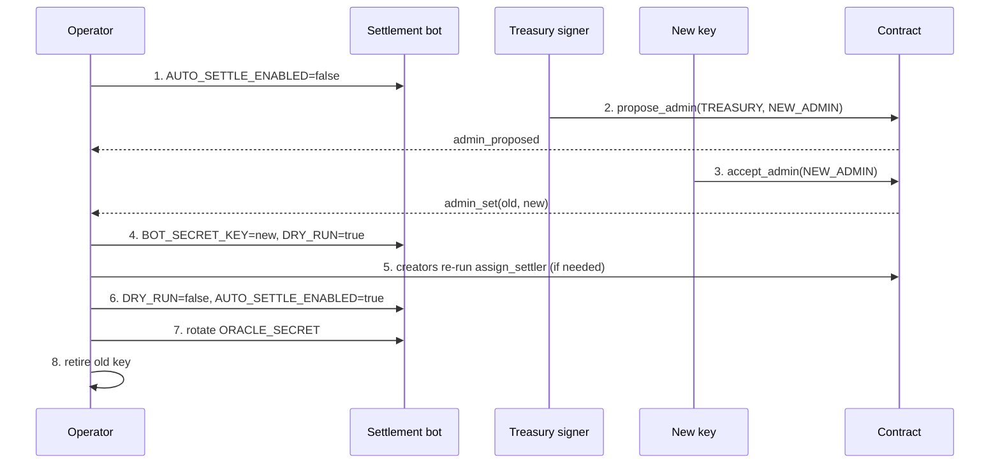

# Oracle Key Rotation Procedure

This guide is for operators who rotate the key that resolves Predinex markets. Read [`ORACLE_CONFIGURATION_GUIDE.md`](./ORACLE_CONFIGURATION_GUIDE.md) first. It explains why the "oracle" in this protocol is the **settlement authority**, meaning whoever is allowed to call `settle_pool`.

## What is being rotated

In production, three credentials together make up "the oracle key":

| Credential | Where it lives | What it authorizes | Rotated by |
|---|---|---|---|
| **Settlement signer**: the contract admin (`get_admin`) | `BOT_SECRET_KEY` in the settlement bot | `settle_pool` / `settle_pools` on **every** pool (`SettlementSource::Admin`). The admin can also call `set_paused` and `set_max_protocol_fee_bps`. | Two-step `propose_admin` → `accept_admin` (§3, steps 2–3) |
| **Per-pool delegated settlers** (`get_delegated_settler(pool_id)`) | Same key, if creators delegated to the bot | `settle_pool` on that pool only (`SettlementSource::Operator`) | The pool creator calls `assign_settler` again (§3, step 5) |
| **Resolution-oracle credential** | `ORACLE_SECRET` (and `ORACLE_URL`) in the bot | Off-chain: lets the bot fetch outcomes from `GET {ORACLE_URL}/resolve/{poolId}` | The oracle provider, then a bot redeploy (§3, step 7) |

The settlement signer is the one that matters for funds. A leaked admin key can settle any expired pool to any backed outcome.

> There is no `revoke_settler`. A delegated settler stays authorized on its pool until the creator overwrites it with `assign_settler`, or the pool is settled.

---

## 1. Preconditions

Do not start until every item is checked:

- [ ] **Treasury recipient signer is available.** Only the treasury recipient (`get_treasury_recipient`) can call `propose_admin`. Without it, the admin key cannot be rotated.
- [ ] **New keypair exists** in the secrets manager, was generated offline or in an HSM, and has never been written to the bot host's disk in plain text.
- [ ] **New account is funded** on the target network with enough XLM for the base reserve and transaction fees. `accept_admin` must be signed and paid by the new key.
- [ ] **No admin transfer is already pending:** `get_pending_admin` returns `None`. If it returns an address, find out why before you continue. A stale pending address can still call `accept_admin`.
- [ ] **Current state is recorded** in the change ticket: `get_admin`, `get_treasury_recipient`, `get_freeze_admin`, `is_paused`, `get_dispute_window`, `get_stale_oracle_threshold`. Also record the list of open pools where `get_delegated_settler(pool_id)` equals the old key.
- [ ] **Rehearsed on testnet** against a contract with the same version, within the last 30 days.
- [ ] **Timing:** no large batch of pools is about to expire. Settlement is stopped while you rotate (§3, step 1), so choose a quiet window.
- [ ] If `get_stale_oracle_threshold() > 0`, check that whatever calls `update_twap` is **not** the bot being stopped. Otherwise pools will go stale and `settle_pool` will reject them after the rotation.

Use the two-step `propose_admin` / `accept_admin`, **not** `set_admin`. `set_admin` takes effect immediately with no confirmation from the new key, so a mistyped address permanently moves admin authority to a key nobody holds.

Shell variables used below:

```bash
export CONTRACT_ID=C...
export NETWORK=mainnet
export TREASURY=G...      # treasury recipient
export OLD_ADMIN=G...     # current get_admin()
export NEW_ADMIN=G...     # new settlement signer
```

---

## 2. Rotation at a glance



## 3. Transaction order

Follow these steps in order. Do not start a step until the previous step's check has passed.

### Step 1: Stop automatic settlement

Set `AUTO_SETTLE_ENABLED=false` in the bot environment and restart it. Wait one `POLL_INTERVAL_MS` and confirm in the logs that no `settle_pools` transaction is still pending (the bot polls each transaction for up to `TX_POLL_MAX_ATTEMPTS × TX_POLL_INTERVAL_MS`).

*Check:* the bot logs expired pools as needing settlement but submits nothing.

### Step 2: Propose the new admin (treasury signer)

```bash
stellar contract invoke --id $CONTRACT_ID --source treasury --network $NETWORK \
  -- propose_admin --caller $TREASURY --new_admin $NEW_ADMIN
```

*Check:* `get_pending_admin` returns `$NEW_ADMIN`, and an `admin_proposed` event shows the expected caller. `get_admin` still returns `$OLD_ADMIN`, so the old key keeps working until step 3.

### Step 3: Accept with the new key

```bash
stellar contract invoke --id $CONTRACT_ID --source new-admin --network $NETWORK \
  -- accept_admin --caller $NEW_ADMIN
```

*Check:* `get_admin` returns `$NEW_ADMIN`, `get_pending_admin` returns `None`, and an `admin_set` event shows `old = $OLD_ADMIN, new = $NEW_ADMIN`.

From this moment, a `settle_pools` call signed by the old key **still succeeds as a transaction**, but every pool in it returns `error_code: 3` (`Unauthorized`). This is why the bot was stopped in step 1.

Possible errors: `NoPendingAdminTransfer` (91) means step 2 did not land. `Unauthorized` (3) means the signer is not the pending address.

### Step 4: Point the bot at the new key, in dry-run mode

Update `BOT_SECRET_KEY` in the secrets manager, set `DRY_RUN=true`, keep `AUTO_SETTLE_ENABLED=false` for now, and redeploy.

*Check:* `GET /readyz` returns healthy. The bot does not log its public key, so derive it yourself from the stored secret (for example `stellar keys address new-admin`) and compare it with `get_admin`.

### Step 5: Re-delegate per-pool settlers (only if used)

For each open pool recorded in the preconditions, the **pool creator** calls:

```bash
stellar contract invoke --id $CONTRACT_ID --source <creator> --network $NETWORK \
  -- assign_settler --creator <CREATOR> --pool_id <ID> --settler $NEW_ADMIN
```

*Check:* `get_delegated_settler(pool_id)` returns `$NEW_ADMIN` and an `assign_settler` event is emitted. You can skip this step for pools that the new admin key will settle as admin anyway, but the stale delegation to the old key then stays valid until the pool settles.

### Step 6: Resume settlement

Run one cycle with `DRY_RUN=true, AUTO_SETTLE_ENABLED=true` and check the outcomes it would submit. Then set `DRY_RUN=false`.

*Check:* the first live `settle_pools` result has `success: true` for every pool, with no `error_code: 3`.

### Step 7: Rotate the resolution-oracle credential

1. Ask the oracle provider for a new bearer token, with both old and new tokens valid during an overlap period.
2. Update `ORACLE_SECRET` (and `ORACLE_URL`, if it changes) and redeploy the bot.
3. Confirm that oracle requests succeed in the bot logs: no 401/403 responses, and no rise in `upstreamTimeouts`.
4. Ask the provider to revoke the old token.

Keep `ORACLE_FALLBACK_TO_DEFAULT=false` throughout. If the oracle fails mid-rotation, pools should be skipped, not settled to `DEFAULT_WINNING_OUTCOME`.

### Step 8: Retire the old key

Remove `$OLD_ADMIN` from the secrets manager and from every host and CI secret. If you suspect it was compromised, also remove its signing weight on the Stellar account (`set_options` with master weight `0`), so it cannot sign anything else.

---

## 4. Rollback

| Failure point | State | Rollback |
|---|---|---|
| Step 2 landed, step 3 not yet | Old key is still admin; new key is pending | Call `propose_admin` again with `--new_admin $OLD_ADMIN`, then `accept_admin` from the old key. This **clears the pending entry**. There is no cancel call, and a stale pending address stays able to accept until it is overwritten. |
| Step 3 landed, new key is unusable (lost, wrong host, misconfigured) | New key is admin | From the treasury signer, run steps 2–3 again with `--new_admin $OLD_ADMIN` (only if the old key is **not** compromised), or with another fresh key. Then restore `BOT_SECRET_KEY`. |
| Step 5 partially applied | Mixed delegations | Each creator re-runs `assign_settler` with the intended key. Delegations are per pool and independent of each other. |
| Step 6 shows `Unauthorized` (3) | Bot key ≠ admin | Set `AUTO_SETTLE_ENABLED=false` again, compare the bot's derived public key with `get_admin`, and fix the secret before you resume. |
| Step 7 oracle auth failures | Bot cannot resolve outcomes | Restore the old `ORACLE_SECRET` while it is still within the overlap period. Pools are skipped in the meantime, not mis-settled. |
| Treasury signer itself is lost | Admin cannot be changed | Not recoverable by rotation. Escalate per [`PAUSED_CONTRACT_RUNBOOK.md`](./PAUSED_CONTRACT_RUNBOOK.md#33-if-the-pausing-key-may-be-compromised). |

**Never roll back to a key you suspect is compromised.** If the old key leaked, roll forward to a second fresh key. If you need to stop settlement and claims while you do that, pause the contract first: `propose_admin` and `accept_admin` both work while the contract is paused.

---

## 5. Verification

Run these checks after step 6, and again 24 hours later:

| Check | Expected |
|---|---|
| `get_admin` | `$NEW_ADMIN` |
| `get_pending_admin` | `None` |
| `admin_proposed`, `admin_set` events | Exactly one of each for this rotation, with the expected addresses. Any extra event is a SEV-1. |
| Audit log | `propose_admin` (caller `$TREASURY`) and `accept_admin` (caller `$NEW_ADMIN`) entries |
| Next settled pool | `settle_pool` event `caller == $NEW_ADMIN`; `get_settlement_source(pool_id) == Admin` (or `Operator` for re-delegated pools) |
| Old key | On testnet, `settle_pool` signed by the old key fails with `Unauthorized` (3). On mainnet, simulate the call and **do not submit** it. |
| Delegations | No open pool has `get_delegated_settler(pool_id) == $OLD_ADMIN`, unless that was intentionally left in place |
| Bot health | `/readyz` healthy; settlement lag back to baseline in `/health/metrics` |
| Oracle | Old `ORACLE_SECRET` is rejected by the provider; the new one is accepted |
| Unchanged config | `get_treasury_recipient`, `get_freeze_admin`, `is_paused`, `get_dispute_window` match the values recorded in the preconditions |

Attach the before/after values and the transaction hashes from steps 2, 3 and 5 to the change ticket.
